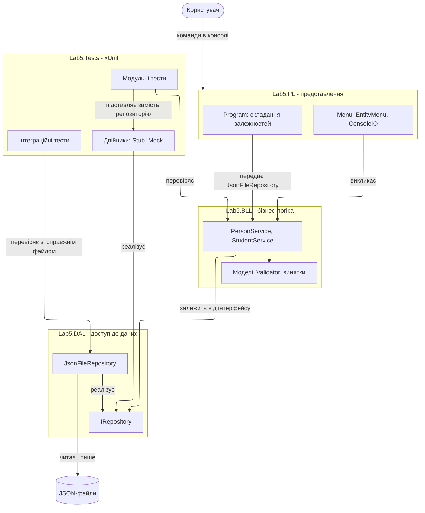
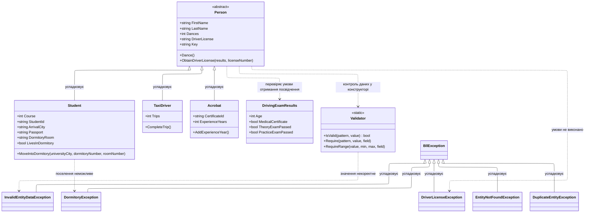
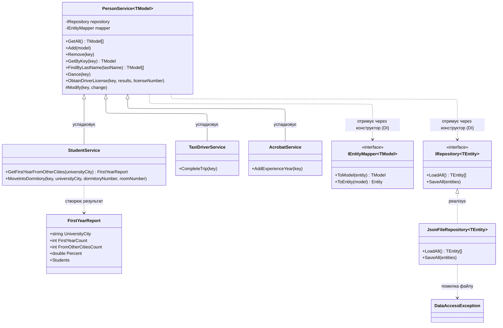
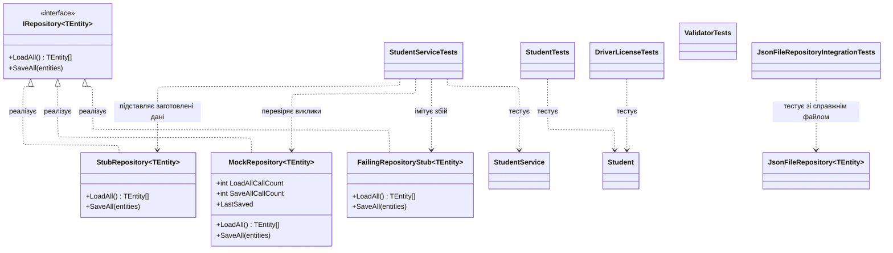
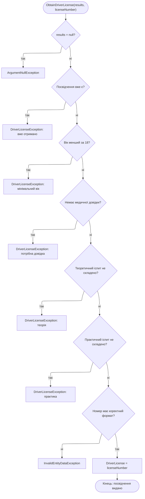
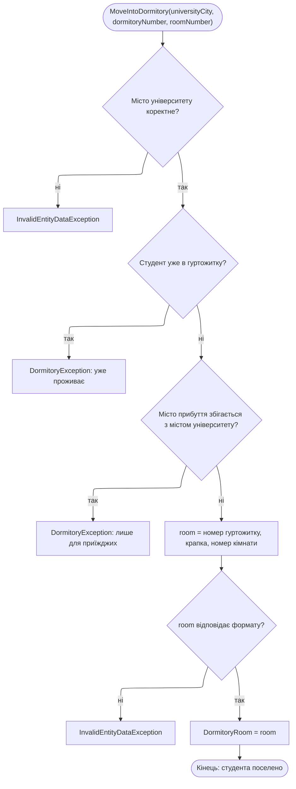
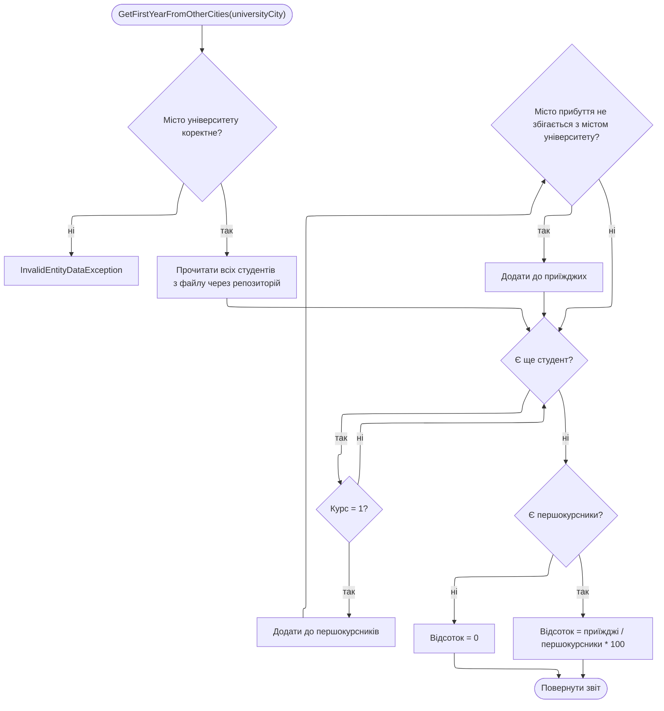
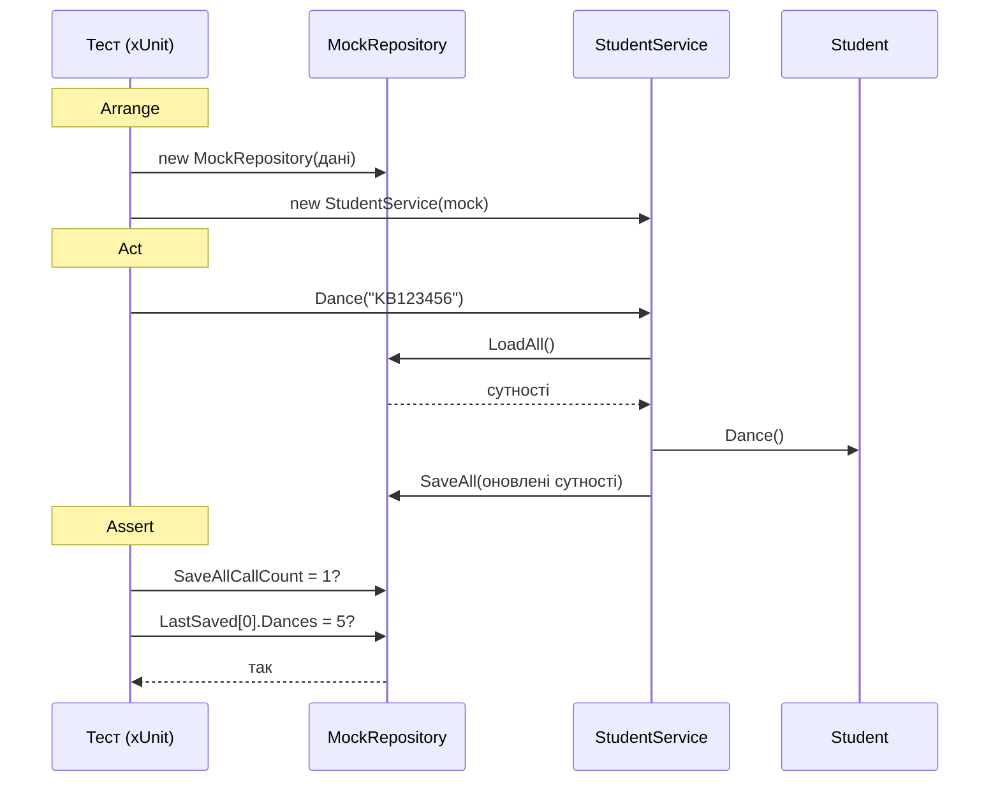

# Схеми до лабораторної роботи 3.5 - варіант 2

## 1. Архітектура та місце тестів

## 2. Діаграми класів

### 2.1. Моделі та винятки (BLL)

### 2.2. Сервіси та ін'єкція залежностей

### 2.3. Тести та двійники

## 3. Алгоритм Person.ObtainDriverLicense

## 4. Алгоритм Student.MoveIntoDormitory

## 5. Операція варіанта: відсоток студентів 1-го курсу з інших міст

## 6. Взаємодія об'єктів у модульному тесті з мок-об'єктом

